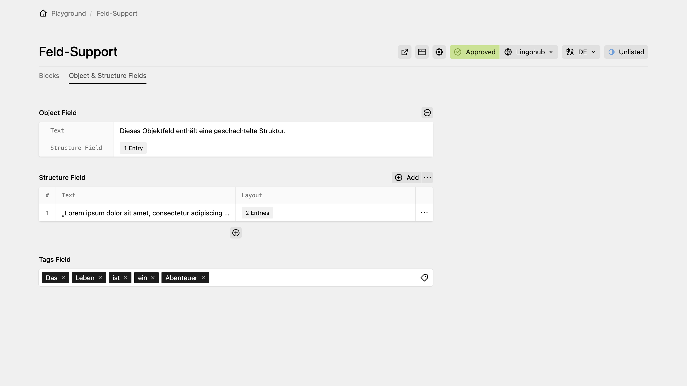
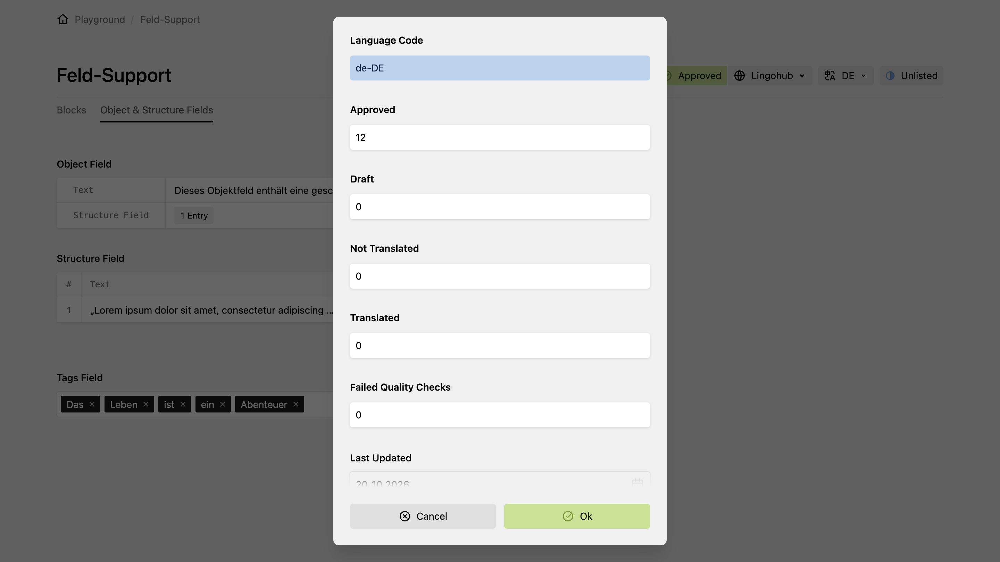
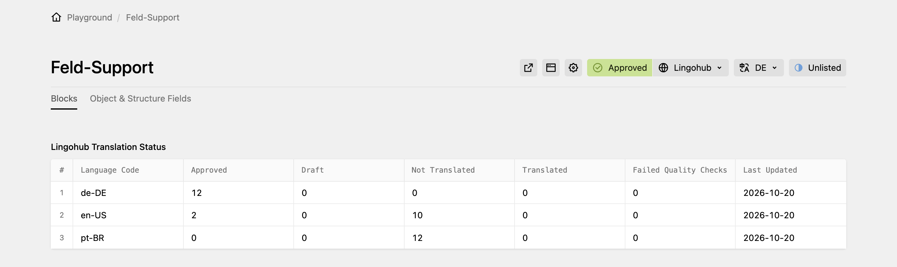
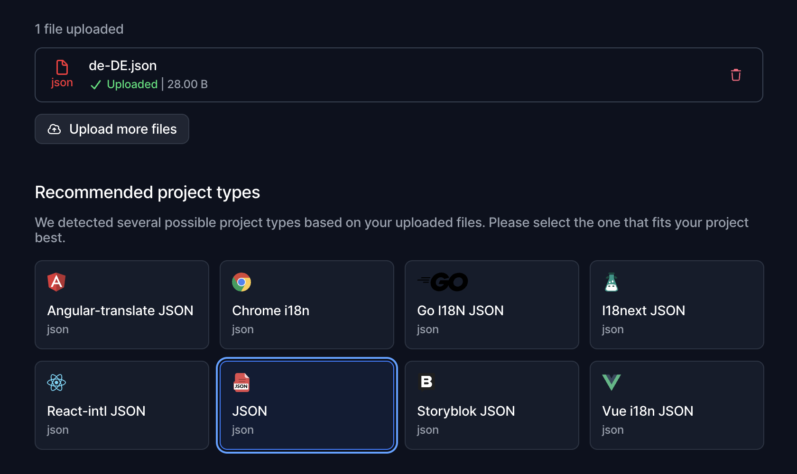

<div align="center">
  

# Kirby Lingohub

Kirby Lingohub is a plugin for [Kirby CMS](https://getkirby.com) that syncs content with the [Lingohub](https://lingohub.com) translation service – blocks, layouts, structures, and objects included, even blocks nested in custom blocks.

[Setup](#setup) •
[Options](#options) •
[Field Options](#field-options) •
[Key Format](#key-format)

</div>

## When to Use

| I want to…                                      | Use                       |
| ----------------------------------------------- | ------------------------- |
| Upload and download translations from the Panel | `lingohub` view button    |
| See each language's translation status          | `lingohub-status` section |
| Change a field's translations only in Lingohub  | `translateExternalOnly`   |
| Translate a field only in Kirby                 | `translateInKirbyOnly`    |
| Keep a field out of Lingohub                    | `translate: false`        |

## Features

### ☁️ Upload and Download

The `lingohub` view button opens a dropdown with **Upload** and **Download Translations**. Add it to the `buttons` of a page, Site, or file blueprint:

```yml
buttons:
  - preview
  - settings
  - lingohub
  - languages
  - status
```

**Upload** sends the languages you pick: the default language, preselected, and the translations that already exist in Kirby. Translations with no translated, draft, or approved segments in Lingohub yet are preselected too – handy when you move an existing site to Lingohub. Lingohub imports an upload in the background, and the status updates once it has, usually after a few seconds.

**Download Translations** fetches the segments of the chosen status – **All**, **Translated and Approved**, or **Approved** (the default) – and writes them into each selected language. Languages whose segments are all approved are preselected. A segment the download doesn't include keeps the language's current text, or the default language's if it has none. Only users who may update the page, Site, or file can download into it. A download that changes the title also needs the `changeTitle` permission.

> [!NOTE]
> Kirby 4 has no custom view buttons. The plugin backports the `lingohub` button to page views and places it before the languages dropdown.

### 🚦 Translation Status

Next to the dropdown, a status button shows the current language's [status in Lingohub](https://help.lingohub.com/en/articles/6683154-how-to-manage-your-translation-workflow-using-statuses): **Approved** once all its segments are approved, **In Translation** while some aren't, and **Not Uploaded** before the first upload. Click it for the segment counts per status, the failed quality checks, and the date of the last update. If the status can't be loaded, e.g. because Lingohub rejects the API key, the button reads **Unavailable** and a click shows the error.





The `lingohub-status` section lists the same counts for every language of the page, Site, or file that Lingohub holds, or the error if the status can't be loaded:

```yml
sections:
  lingohubStatus:
    type: lingohub-status
    label: Translation Status
```



### 🔒 Translate Only in Lingohub

Top-level fields with `translateExternalOnly` stay editable in the default language, but non-admins can't save a changed value in any other language. Use it for fields whose translations belong to Lingohub alone, so its translation memory stays consistent.

### 🏠 Translate Only in Kirby

Fields with `translateInKirbyOnly` never leave Kirby: uploads skip them, and downloads keep each language's own value – useful for images or files that differ per language.

## Requirements

- Kirby 4 or Kirby 5

## Installation

### Composer (Recommended)

```bash
composer require johannschopplich/kirby-lingohub
```

### Manual Installation

Download and copy this repository to `/site/plugins/kirby-lingohub`.

## Setup

### 1. Kirby Languages

The plugin needs a multi-language site. Give every language a `locale`: the plugin derives the Lingohub language code from it, with `_` replaced by `-` and a `.UTF-8` suffix dropped. With an array `locale`, it reads the `LC_ALL` entry. A language without a locale falls back to its code.

```php
# /site/languages/en.php
return [
    'code' => 'en',
    'default' => true,
    'locale' => 'en_US', // Lingohub: `en-US`
    'name' => 'English'
];
```

### 2. Lingohub Project

Create a project in your Lingohub workspace and choose **File import**. Lingohub won't continue without a first file, so upload a JSON file named after the default language's code, e.g. `en-US.json` with `{"title": "Home"}`. Then pick the project type **JSON**:



Lingohub detects the source language from the file name. Add the other Kirby languages as targets, with the language codes derived from the locales: `en-US` for `en_US`, `de-DE` for `de_DE`.

Then [create an API key](https://help.lingohub.com/en/articles/16308304-managing-api-keys-in-your-workspace-settings) for the workspace with full permissions for **Resources** – uploads, downloads, and the status need nothing else.

### 3. Plugin Options

Copy the workspace and project IDs from the Lingohub URLs:

- `workspace/space_16kPs3bRIpXi-29323/dashboard` → workspace ID `space_16kPs3bRIpXi-29323`
- `project/pr_18JCETCbT9NW-31003/branches` → project ID `pr_18JCETCbT9NW-31003`

Add them and the API key to your `config.php`, see [Options](#options). Then add the `lingohub` button and, if you like, the `lingohub-status` section to your blueprints.

## Options

All options are namespaced under `johannschopplich.lingohub`. Each is required, and the Panel shows an error while one is missing.

| Option        | Default | Description                                           |
| ------------- | ------- | ----------------------------------------------------- |
| `apiKey`      | –       | Lingohub API key with full **Resources** permissions. |
| `workspaceId` | –       | ID of the Lingohub workspace.                         |
| `projectId`   | –       | ID of the Lingohub project.                           |

Example `config.php`:

```php
return [
    'languages' => true,

    'johannschopplich.lingohub' => [
        'apiKey' => env('LINGOHUB_API_KEY'),
        'workspaceId' => 'space_16kPs3bRIpXi-29323',
        'projectId' => 'pr_18JCETCbT9NW-31003'
    ]
];
```

## Field Options

Uploads include the page or Site title and every text-like field: `list`, `tags`, `text`, `textarea`, `writer`, `markdown`, and custom fields that extend one of them – also inside blocks, layouts, structures, and objects. Hidden blocks are skipped. Three blueprint options change what goes to Lingohub:

| Option                        | Upload  | Download                                         |
| ----------------------------- | ------- | ------------------------------------------------ |
| `translate: false`            | Skipped | Takes the default language's value, like Kirby   |
| `translateInKirbyOnly: true`  | Skipped | Keeps the language's own value                   |
| `translateExternalOnly: true` | Sent    | Written; non-admins can't change it in the Panel |

```yml
fields:
  text:
    type: blocks
    translateExternalOnly: true
  image:
    type: files
    translateInKirbyOnly: true
```

`translateExternalOnly` covers the top-level fields of pages, the Site, and files. Admins and the default language are exempt.

> [!IMPORTANT]
> Set `translateInKirbyOnly` on fields, not on block fieldsets: Kirby drops unknown keys at a fieldset's root.

## Key Format

Lingohub's **JSON (Standard)** format is a flat key–value map, and a segment keeps its translations only as long as its key stays the same. The plugin joins the names along a value's path with `_`:

| Field           | Key                                        |
| --------------- | ------------------------------------------ |
| Text-like field | `{field}`                                  |
| Structure       | `{field}_{rowIndex}_{subfield}`            |
| Object          | `{field}_{subfield}`                       |
| Blocks          | `{field}_{blockId}_{blockType}_{subfield}` |
| Layout          | `{field}_{blockId}_{blockType}_{subfield}` |

Nested fields continue the chain, e.g. blocks inside a custom block: `{field}_{blockId}_{blockType}_{subfield}_{nestedBlockId}_{nestedBlockType}_{nestedSubfield}`. Layout and column IDs are not part of a key.

Each model is one Lingohub resource per language. Its path is the page or file ID (`site` for the Site), its file name `{blueprint}_{locale}.json`, e.g. `notes/my-note/note_de-DE.json`. The ID holds neither the draft status nor the sorting number, so publishing or sorting a page keeps its resource. Changing a page's slug, moving it, or renaming a file changes the path, and changing a model's template or a language's locale changes the file name, so Lingohub treats it as a new resource.

## License

[MIT](./LICENSE) License © 2025-PRESENT [Johann Schopplich](https://github.com/johannschopplich)
